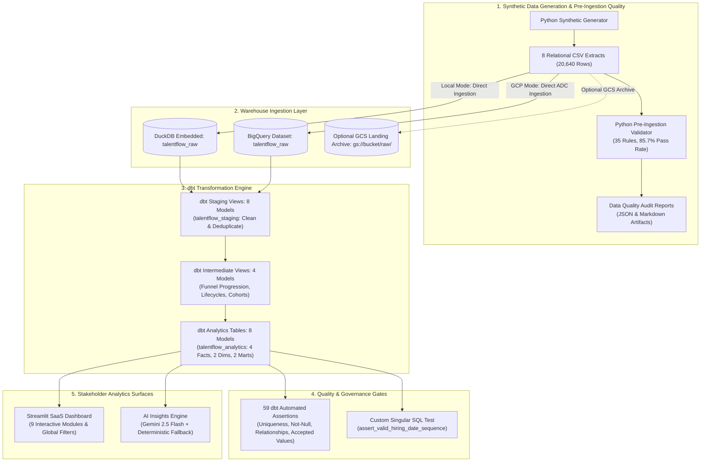

# TalentFlow Analytics

### Cloud-Native Recruiting & Workforce Intelligence Platform

[](https://www.python.org/downloads/)
[](https://docs.getdbt.com/)
[](https://docs.getdbt.com/)
[](https://pytest.org/)
[](https://duckdb.org/)
[](https://cloud.google.com/bigquery)
[](https://streamlit.io/)

An end-to-end analytics engineering platform that bridges recruiting, workforce, and employee lifecycle data to deliver governed business intelligence, interactive SaaS-style dashboards, automated multi-tier data quality monitoring, and AI-assisted analytics.

TalentFlow Analytics connects upstream talent acquisition funnels (sourcing, candidate screening, technical evaluations, onsite interview loops, offers) with downstream workforce retention dynamics (tenure, annualized department turnover, engagement survey sentiment, and performance ratings).

---

> ### Independent Portfolio & Synthetic Data Notice
> - **Synthetic Data**: 100% of data processed by this platform is algorithmically synthesized using reproducible random seeds and realistic statistical distributions (~20,640 records across 8 relational tables). No real candidate, employee, compensation, or proprietary organizational records are included.
> - **Independent Analytics Engineering Project**: This is an independent portfolio platform designed to demonstrate modern data stack best practices (Kimball dimensional modeling, automated testing, cloud-native warehouse architecture, and BI development). It does not claim live enterprise HRIS/ATS integrations or an active production deployment SLA.

---

## 1. Executive Summary & Business Problem

Modern organizations frequently struggle with fragmented People Operations data: Applicant Tracking Systems (ATS), Human Resource Information Systems (HRIS), and Employee Engagement platforms operate in disconnected silos. TalentFlow Analytics consolidates these operational domains into a governed dimensional data warehouse, empowering talent leaders and executives to answer critical strategic questions:

- **Recruiting Funnel Velocity**: Where in the hiring loop do candidates drop off, and what are the primary stage transition latencies?
- **Sourcing Channel ROI**: Which channels (Referrals, LinkedIn, Campus, Direct Sourcing, Agencies) deliver the highest conversion rates, best retention, and lowest unit cost per hire?
- **Workforce Retention Dynamics**: Which departments, job tiers, and locations experience early turnover (&le; 180 days)?
- **Employee Sentiment & Retention**: How does employee sentiment across 5 survey dimensions (satisfaction, career growth, management effectiveness, work-life balance) correlate with turnover risk?
- **Data Governance & Security**: How are sensitive workforce attributes secured using least-privilege cloud IAM, dataset isolation, and column-level masking?

---

## 2. Platform Architecture

TalentFlow Analytics implements a dual-engine architecture that provides an identical analytical surface across local development and cloud warehouse environments:

1. **Local Development Mode**: DuckDB embedded analytical engine, local CSV storage, and `dbt-duckdb` adapter — operates completely offline with zero cloud credentials or infrastructure cost.
2. **Cloud Warehouse Mode (Google BigQuery)**: Google BigQuery enterprise data warehouse with date partitioning, clustering, Application Default Credentials (ADC) OAuth authentication, and `dbt-bigquery` adapter. Google Cloud Storage (GCS) is supported as an optional landing/archival layer.



---

## 3. Technology Stack

- **Data Transformation**: `dbt Core 1.12.7` utilizing `dbt-duckdb` (local) and `dbt-bigquery` (cloud)
- **Analytics Warehouses**:
  - `DuckDB 1.1` (Local Embedded Analytics Engine)
  - `Google BigQuery` (Cloud Data Warehouse with ADC OAuth authentication)
- **Cloud Storage (Optional)**: `Google Cloud Storage (GCS)` (Optional raw extract landing/archival layer)
- **Data Engineering & Modeling**: Python 3.12+, Pandas 2.2+, NumPy, PyArrow
- **Interactive UI & Dashboards**: Streamlit 1.42+, Plotly 6.0+ (9-module SaaS enterprise interface)
- **Automated Testing & CI**:
  - `pytest 9.2` (26 automated Python tests: generation, validation, orchestration, warehouse cleanup)
  - `dbt test` (59 schema assertions, referential integrity tests, and singular SQL rules)
- **AI Analytics**: Google Gemini 2.5 Flash via `google-genai` SDK with deterministic, zero-hallucination rules engine fallback
- **Containerization & Runbook**: Multi-stage Dockerfile and Cloud Run deployment blueprint

---

## 4. Dimensional Data Modeling (20 dbt Models)

The data warehouse transformation project is structured into three distinct layers following Kimball dimensional modeling principles:

```
dbt_project/models/
├── staging/       # 8 views  (cleaning, type casting, standardization, deduplication)
├── intermediate/  # 4 views  (business logic, funnel derivation, lifecycle joins)
└── marts/         # 8 tables (4 facts, 2 dimensions, 2 aggregated KPI marts)
```

### Staging Layer (8 Views &bull; Schema: `staging`)

Staging views clean raw inputs, normalize data types, deduplicate records via window functions, and standardize string representations across both DuckDB and BigQuery:

| Model | Source Table | Key Transformations & Deduplication Logic |
|---|---|---|
| `stg_candidates` | `candidates` | Normalizes emails and locations; deduplicates duplicate submissions using `qualify row_number() over (partition by candidate_id order by updated_at desc) = 1`. |
| `stg_applications` | `applications` | Standardizes stage names to uppercase (`APPLIED`, `SCREENING`, `TECHNICAL`, `ONSITE`, `OFFER`, `HIRED`, `REJECTED`); coalesces missing departments; removes duplicate application IDs. |
| `stg_interviews` | `interviews` | Casts scores (1–5 scale) and durations in minutes; validates round types (`Screen`, `Technical`, `Onsite`, `Leadership`). |
| `stg_offers` | `offers` | Casts base salary, bonus, and equity; parses offer status (`Accepted`, `Declined`, `Pending`). |
| `stg_employees` | `employees` | Standardizes employment statuses (`Active`, `Resigned`, `Terminated`); parses manager hierarchies and job ladder tiers (`L1` to `M2`). |
| `stg_engagement_surveys` | `engagement_surveys` | Validates 1–5 Likert scales across satisfaction, work-life balance, career growth, and manager effectiveness. |
| `stg_departments` | `departments` | Master catalog of business departments, executive leads, and cost center codes. |
| `stg_recruiting_sources` | `recruiting_sources` | Master catalog of acquisition channels with unit cost per posting. |

### Intermediate Layer (4 Views &bull; Schema: `intermediate`)

Intermediate models apply business transformations, calculate funnel durations, and establish relational links between candidate sourcing and employee tenure:

| Model | Business Grain | Description & Derived Metrics |
|---|---|---|
| `int_candidate_application_history` | `candidate_id` | Aggregates application frequency, multi-department submissions, ever-interviewed flags, and ultimate hire outcomes. |
| `int_recruiting_funnel` | `application_id` | Flattens the candidate journey by joining applications, interviews, offers, and candidates; derives binary progression flags (`stage_applied`, `stage_screen`, `stage_tech`, `stage_onsite`, `stage_offer`, `stage_hired`) and stage duration latencies. |
| `int_employee_lifecycle` | `employee_id` | Combines employee records with original recruitment channel, application history, compensation, and averaged engagement scores. |
| `int_employee_retention` | `(hire_cohort_month, department_id, recruiting_source, job_level)` | Aggregates monthly hiring cohorts; computes cohort headcount, active count, departed count, and retention rates across 90-day, 180-day, and 1-year milestones. |

### Analytics Marts (8 Tables &bull; Schema: `analytics`)

The dimensional marts provide high-performance query surfaces optimized for executive reporting and interactive dashboard consumption:

```
                    ┌──────────────────────────┐
                    │      dim_department      │
                    │──────────────────────────│
                    │ PK: department_id        │
                    └────────────┬─────────────┘
                                 │
           ┌─────────────────────┼─────────────────────┐
           │ 1:N                 │ 1:N                 │ 1:N
           ▼                     ▼                     ▼
┌──────────────────────┐ ┌──────────────────────┐ ┌──────────────────────┐
│fct_recruiting_pipeln │ │fct_employee_lifecycle│ │fct_candidate_expernc │
│──────────────────────│ │──────────────────────│ │──────────────────────│
│ PK: application_id   │ │ PK: employee_id      │ │ PK: interview_id     │
│ FK: candidate_id     │ │ FK: candidate_id     │ │ FK: application_id   │
│ FK: department_id    │ │ FK: department_id    │ │ FK: department_id    │
│ FK: recruiting_source│ │ FK: manager_id       │ │ FK: interviewer_id   │
└──────────┬───────────┘ └──────────┬───────────┘ └──────────────────────┘
           │                        │
           │ 1:N                    │ 1:N (is_attrition = 1)
           ▼                        ▼
┌──────────────────────┐ ┌──────────────────────┐
│ dim_recruiting_source│ │fct_employee_attrition│
│──────────────────────│ │──────────────────────│
│ PK: source_id        │ │ PK: employee_id      │
└──────────────────────┘ │ FK: department_id    │
                         └──────────────────────┘
```

#### Fact Tables (4 Models)
1. **`fct_recruiting_pipeline`**:
   - **Grain**: One row per candidate application (`application_id`).
   - **Business Keys & Foreign Keys**: `application_id` (PK), `candidate_id` (FK), `department_id` (FK), `recruiting_source` (FK).
   - **Dimensions & Metrics**: Binary stage progression flags, stage-to-stage transition days (`time_to_screen_days`, `time_to_tech_days`, `time_to_hire_days`), candidate feedback ratings, offer salary.
   - **BigQuery Physical Optimization**: Partitioned monthly by `application_date` and clustered by `["department_id", "recruiting_source"]`.
2. **`fct_employee_lifecycle`**:
   - **Grain**: One row per hired employee (`employee_id`).
   - **Business Keys & Foreign Keys**: `employee_id` (PK), `candidate_id` (FK), `application_id` (FK), `department_id` (FK), `manager_id` (FK).
   - **Dimensions & Metrics**: `hire_date`, `termination_date`, `employment_status`, `is_active`, `is_attrition`, tenure in days/months, tenure bands (`< 90 Days`, `90-180 Days`, `180-365 Days`, `1-2 Years`, `2+ Years`), compensation, performance ratings, and 5-dimension engagement scores.
   - **BigQuery Physical Optimization**: Partitioned monthly by `hire_date` and clustered by `["department_id", "recruiting_source"]`.
3. **`fct_employee_attrition`**:
   - **Grain**: One row per departed employee (`employee_id` where `is_attrition = 1` and `termination_date is not null`).
   - **Business Keys & Foreign Keys**: `employee_id` (PK), `candidate_id` (FK), `department_id` (FK).
   - **Dimensions & Metrics**: Departure timing, departure type (`Resigned`, `Terminated`), exit tenure bands, last performance rating, base salary, and pre-exit engagement scores.
4. **`fct_candidate_experience`**:
   - **Grain**: One row per completed interview round (`interview_id`).
   - **Business Keys & Foreign Keys**: `interview_id` (PK), `application_id` (FK), `department_id` (FK), `interviewer_id` (FK).
   - **Dimensions & Metrics**: Interview round, interviewer score, candidate feedback rating (1–5 scale), duration minutes, sentiment categorization (`Positive`, `Neutral`, `Negative`).

#### Dimension Tables (2 Models)
1. **`dim_department`**:
   - **Grain**: One row per business department (`department_id`).
   - **Attributes & Metrics**: `department_name`, `department_lead`, `cost_center`, `total_historic_hires`, `active_headcount`, `total_attrition`, `historic_attrition_rate_pct`, `avg_tenure_months`, `avg_performance_rating`, and `avg_department_engagement`.
2. **`dim_recruiting_source`**:
   - **Grain**: One row per recruiting channel (`source_id`).
   - **Attributes & Metrics**: `source_name`, `source_channel`, `cost_per_posting`, `total_applications`, `total_hires`, `app_to_hire_conversion_pct`, `offer_acceptance_rate_pct`, `avg_time_to_hire_days`, `employees_churned`, `employee_churn_rate_pct`, and `avg_employee_engagement`.

#### Aggregated KPI Marts (2 Models)
1. **`mart_recruiting_kpis`**:
   - **Grain**: Aggregated by application month, department, and recruiting source `(application_month, department_id, recruiting_source)`.
   - **Metrics**: Stage volume throughput, stage-to-stage conversion rates (`app_to_screen_rate_pct`, `screen_to_tech_rate_pct`, `tech_to_onsite_rate_pct`, `onsite_to_offer_rate_pct`, `offer_acceptance_rate_pct`, `overall_funnel_efficiency_pct`), average time-to-hire, and average offer compensation.
2. **`mart_workforce_kpis`**:
   - **Grain**: Aggregated by reporting month and department `(reporting_month, department_id)`.
   - **Metrics**: Monthly `new_hires_count`, `terminations_count`, and `net_headcount_change`.

---

## 5. Verified Platform Benchmarks

All metrics and execution benchmarks reported below have been validated across local and cloud environments:

| Benchmark Category | Metric / Check | Verified Result | Verification Scope & Notes |
|---|---|---|---|
| **Synthetic Dataset Volume** | Raw records generated | **20,640 rows** | Across 8 relational CSV files (5,000 candidates, 6,000 applications, 8,000 interviews, 1,500 employees, etc.). |
| **Local Pipeline Runtime** | End-to-end execution | **22.62 seconds** | 10 orchestration steps: synthesis, pre-ingestion check, DuckDB loading, 20 dbt models, 59 dbt tests. |
| **Local dbt Build** | Total build checks passed | **79 / 79 passed** | 20 models compiled & executed + 59 dbt schema & singular assertions passed (0 failures, 0 errors). |
| **Python Automated Tests** | Pytest test suite | **26 / 26 passed** | 26 tests passed (data generation, anomaly validation, pipeline orchestration, GCP config, warehouse cleanup). |
| **Pre-Ingestion Quality** | Pre-ingestion validation | **85.7% pass rate** | 30 / 35 checks passed; 5 controlled anomalies deliberately caught before warehouse load. |
| **dbt Transformation Tests** | dbt schema & singular tests | **59 / 59 passed** | 100% pass rate in DuckDB (`dev`) and Google BigQuery (`bigquery`). |
| **BigQuery Warehouse Status** | Cloud table compilation | **8 tables / 20 models** | 8 raw tables loaded (20,640 rows) and all 20 dbt models compiled and built across live BigQuery runs. |
| **GCS Landing Bucket** | Cloud storage status | **Optional / Unconfigured** | GCS upload is optional; direct DataFrame-to-BigQuery ingestion operates independently without GCS. |
| **Cloud Pipeline Orchestration** | End-to-end cloud runner | **Orchestration Patched** | Orchestrator updated with failure short-circuiting. Full live cloud pipeline rerun intentionally bypassed to save cloud costs. |

---

## 6. Data Quality & Orchestration Framework

TalentFlow Analytics implements a multi-tiered data quality architecture designed to demonstrate how real enterprise data teams protect analytical models from dirty upstream data:

```
Raw Synthetic Data (Controlled Anomalies Injected)
       │
       ▼
[Tier 1: Pre-Ingestion Python Validation] ──> 85.7% Pass Rate (5 Controlled Anomalies Caught)
       │
       ▼
[Tier 2: dbt Staging Deduplication & Cleansing]
       │
       ▼
[Tier 3: dbt 59 Automated Assertions] ───────> 100% Pass Rate (59/59 Tests Passed)
```

### 1. Controlled Anomaly Injection
To evaluate pipeline monitoring under realistic conditions, the data generator injects controlled edge cases:
- **50 duplicate candidate IDs** (~1.0% of candidate records)
- **34 duplicate application IDs** (~0.57% of application records)
- **30 missing/null department IDs** (~0.5% of applications)
- **4 chronological sequence violations** (interviews dated prior to application submission)
- **107 referential integrity mismatches** (unmapped or dirty department string tokens)

### 2. Tier 1: Python Pre-Ingestion Validation (85.7% Pass Rate)
Prior to loading raw data into the warehouse, the `DataQualityValidator` runs **35 assertions** across uniqueness, nullability, accepted values, date sequences, and referential integrity.
- **Result**: 30 passed, 5 flagged (85.7% pass rate).
- The 5 flagged checks match the injected controlled anomalies, confirming that pre-ingestion alerting detects upstream data corruption.
- An audit report is exported as JSON and Markdown in `data/reports/data_quality_report.json`.

### 3. Tier 2: dbt Cleansing & Transformation
Staging models quarantine and resolve these issues:
- Duplicate IDs are deduplicated using window function filters (`qualify row_number() over (partition by id order by updated_at desc) = 1`).
- Missing departments are coalesced to default fallback entries.
- Unmapped string casing is sanitized using standard regex and case mappings.

### 4. Tier 3: dbt Automated Assertions (59 Tests &bull; 100% Pass Rate)
Because dirty data is handled in the staging views, downstream models achieve a **100% pass rate across all 59 dbt tests**:
- **Uniqueness & Not-Null**: Validated on all primary keys across staging, intermediate, and marts.
- **Referential Integrity**: Relationship tests linking applications &rarr; candidates &rarr; departments &rarr; employees.
- **Accepted Values**: Stage transitions and employment statuses.
- **Custom Singular SQL Test (`assert_valid_hiring_date_sequence.sql`)**: Asserts that no hire date precedes an application date in `fct_recruiting_pipeline`, and no termination date precedes a hire date in `fct_employee_lifecycle`.

### 5. Orchestration Circuit Breaker
The pipeline orchestrator (`talentflow/pipeline.py`) includes circuit-breaker logic:
- If `dbt run` encounters a compilation or execution error, the pipeline immediately halts and marks the execution `FAILED`.
- **It explicitly skips `dbt test`**, preventing misleading reports where passing tests on surviving tables might mask an incomplete transformation.
- Loader warehouse connections are wrapped in `try...finally` blocks to guarantee resource release on exception.

---

## 7. Platform Modules & Interactive Dashboard

The interactive Streamlit application (`talentflow/dashboards/app.py`) provides an executive-ready analytics experience structured into **9 dedicated modules**:

| # | Module Name | Core Visualizations & Analytics | Business Problem Addressed |
|---|---|---|---|
| **1** | **Executive Overview** | Headcount scorecard, hiring velocity vs. quarterly targets, net headcount waterfall. | High-level organizational health and growth pace. |
| **2** | **Talent Acquisition Analytics** | Sourcing channel volume vs. hires, conversion % vs. offer acceptance scatter, candidate feedback. | Channel economics, cost-per-hire estimation, and sourcing ROI. |
| **3** | **Recruiting Funnel Intelligence** | Multi-stage Plotly funnel (`Applied` &rarr; `Screen` &rarr; `Tech` &rarr; `Onsite` &rarr; `Offer` &rarr; `Hired`), stage drop-off %, transition cycle times (days). | Bottleneck identification and stage latencies. |
| **4** | **Workforce Analytics** | Geographic hub donut chart, career ladder distribution (`L1` to `M2`), active vs. departed breakdown, tenure histogram. | Workforce composition, career leveling, and geographic distribution. |
| **5** | **Employee Lifecycle Analytics** | 1-year retention by recruiting channel, 5-dimension engagement radar chart, tenure cohort analysis. | Long-term candidate quality and organizational sentiment. |
| **6** | **Retention & Attrition Intelligence** | Departure risk horizon (`<=90d`, `90-180d`, `180-365d`, `>1yr`), exits by department/channel, exit tenure, correlation vs. causation notice. | Turnover risk segmentation and early departure analysis. |
| **7** | **Data Quality & Pipeline Monitoring** | Pre-ingestion audit scorecard (35 checks, 5 anomalies), 59 dbt test logs, column-level security & IAM specifications. | Data pipeline trust, auditability, and governance compliance. |
| **8** | **AI-Powered Business Insights** | Natural language synthesis with Google Gemini 2.5 Flash + deterministic rules fallback; underlying SQL data tables. | Grounded executive summaries for 5 core People Analytics questions. |
| **9** | **Data Platform & Model Documentation** | Interactive Kimball data lineage diagrams, data dictionary, entity schema explorer, runbook commands. | Data platform transparency and self-serve documentation. |

### Global Interactive Filters
Located in the sidebar, these reactive filters update visualizations across all modules:
- **Department**: Multi-select filtering across business units (e.g., *Engineering*, *Sales*, *Product*).
- **Recruiting Source**: Multi-select filtering across candidate acquisition channels.
- **Job Level**: Organizational ladder filtering (`L1 - Associate` through `M2 - Director`).
- **Reset Trigger**: One-click action restoring global filters to full dataset scope.

### AI-Powered Insights Engine
Module 8 offers executive query synthesis for 5 pre-configured strategic questions:
1. *What are the main recruiting funnel bottlenecks?*
2. *Which recruiting sources have the highest conversion?*
3. *Which departments have higher attrition?*
4. *What factors are associated with longer hiring cycles?*
5. *What changed in the latest reporting period?*

- **Grounded Synthesis**: When `GEMINI_API_KEY` is provided, queries execute against warehouse tables and pass structured Markdown data to Gemini 2.5 Flash with strict grounding instructions.
- **Deterministic Fallback**: If no API key is present or the API is unreachable, a deterministic rules engine evaluates metrics directly, providing factual summaries with zero hallucination risk.

---

## 8. Dashboard Previews & Visual Tour

To capture dashboard views for presentations or documentation, the following key views are recommended:

| Screen Reference | Recommended View to Capture | Key Elements Visible |
|---|---|---|
| `docs/screenshots/01_executive_overview.png` | Module 1: Executive Overview | KPI scorecards (Headcount, Active Hires, Avg Time-to-Hire, Turnover Rate), Net Workforce Trajectory chart, Department breakdown. |
| `docs/screenshots/02_recruiting_funnel.png` | Module 3: Funnel Intelligence | Full-width interactive Plotly funnel showing conversion rates and stage drop-offs from application to hire. |
| `docs/screenshots/03_data_quality_audit.png` | Module 7: Data Quality & Governance | Pre-ingestion validation results (35 checks, 5 controlled anomalies detected) alongside 59 passing dbt assertions. |
| `docs/screenshots/04_ai_insights.png` | Module 8: AI Insights | Natural-language executive summary generated by Gemini 2.5 Flash / Deterministic Fallback with underlying metric tables. |

*(Visual assets can be captured directly from `http://localhost:8501` after following the Quickstart below.)*

---

## 9. Quickstart Guide (Local Development Mode)

Local mode runs out-of-the-box using embedded DuckDB. It requires **no cloud credentials, no GCP project, and no external services**.

### 1. Environment Setup
```bash
# Clone repository
git clone https://github.com/Harshateja01/talentflow-analytics-platform.git
cd talentflow-analytics-platform

# Create and activate virtual environment (Windows PowerShell)
python -m venv .venv
.venv\Scripts\Activate.ps1

# (Alternative: macOS / Linux)
# source .venv/bin/activate

# Install dependencies and initialize environment file
pip install -r requirements.txt
cp .env.example .env
```

### 2. Run Local 10-Step Pipeline
```bash
python -m talentflow.pipeline --mode local
```

Expected terminal output upon successful completion (~22 seconds):
```text
================================================================================
TALENTFLOW PIPELINE EXECUTION FINISHED: SUCCESS
Total Duration: 22.62 seconds
Data Quality Pass Rate: 85.7%
Raw Tables Ingested: 20,640 rows across 8 tables
================================================================================
```

### 3. Launch Streamlit Dashboard
```bash
streamlit run talentflow/dashboards/app.py
```
Open **`http://localhost:8501`** in your browser.

### 4. Run Automated Test Suite
```bash
pytest -v
```
Verifies all **26 unit, config, and orchestration tests**.

---

## 10. Google Cloud Deployment Guide (BigQuery with ADC)

TalentFlow Analytics supports cloud execution on **Google BigQuery using Application Default Credentials (ADC)** without requiring a Google Cloud Storage bucket or service account JSON key:

### 1. Authenticate with Google Cloud ADC
```bash
gcloud auth application-default login
```

### 2. Configure Environment Variables
Update `.env` with your Google Cloud project details:
```ini
TALENTFLOW_MODE=gcp
GCP_PROJECT_ID=talentflow-analytics
GCP_REGION=us-central1

# BigQuery Datasets
BQ_RAW_DATASET=talentflow_raw
BQ_STAGING_DATASET=talentflow_staging
BQ_ANALYTICS_DATASET=talentflow_analytics

# Optional GCS landing archive (omit to run in direct BigQuery mode)
# GCS_BUCKET_NAME=talentflow-landing-zone

# Optional Service Account Key (omit when using ADC OAuth)
# GOOGLE_APPLICATION_CREDENTIALS=/path/to/key.json
```

### 3. Run Pipeline on BigQuery
```bash
python -m talentflow.pipeline --mode gcp
```
- Ingests raw CSVs directly into `talentflow_raw` using BigQuery DataFrame loading.
- Executes `dbt run` and `dbt test` against BigQuery datasets using OAuth.

### 4. Optional Cloud Run Container Deployment Blueprint
To containerize and deploy the dashboard as a managed service on Google Cloud Run:
```bash
# Build multi-stage Docker container
docker build -t talentflow-platform .

# Deploy to Cloud Run
gcloud run deploy talentflow-analytics \
    --image gcr.io/talentflow-analytics/talentflow-platform \
    --platform managed \
    --region us-central1 \
    --allow-unauthenticated
```

---

## 11. Verification Matrix

| Component | Target System | Verification Status | Implementation & Verified Results |
|---|---|---|---|
| **Synthetic Data Generator** | Local / Offline | **VERIFIED** | Generates 8 relational CSV files (~20,640 rows) with controlled edge cases. |
| **Pre-Ingestion Validator** | Local / Offline | **VERIFIED** | 35 checks evaluated; 5 controlled anomalies identified (85.7% pass rate); report saved. |
| **DuckDB Analytics Warehouse** | Local / Offline | **VERIFIED** | Embedded database loads raw tables and executes transformations in ~22s. |
| **dbt Transformations (20 Models)** | DuckDB & BigQuery | **VERIFIED** | 8 staging views, 4 intermediate views, 8 marts tables compiled and built across runs. |
| **dbt Automated Tests (59 Tests)** | DuckDB & BigQuery | **VERIFIED** | 59/59 schema, referential integrity, and singular tests pass (0 failures, 0 errors). |
| **Python Test Suite (26 Tests)** | pytest | **VERIFIED** | 26/26 tests passed (data generation, validation, GCP configuration, orchestration circuit-breaker, warehouse cleanup). |
| **Streamlit SaaS Dashboard** | Browser / Local | **VERIFIED** | 9 interactive modules render with responsive Plotly visualizations and global filtering. |
| **AI Insights Engine** | Offline / Gemini | **VERIFIED** | Deterministic rules fallback operates offline; Gemini 2.5 Flash activates with API key. |
| **BigQuery Direct ADC Mode** | Cloud GCP | **VERIFIED** | Ingests 8 raw tables and compiles all 20 models with dbt OAuth without GCS bucket. |
| **GCS Archival Landing Zone** | Cloud GCP | **OPTIONAL** | Code complete and verified optional; bypassed when `GCS_BUCKET_NAME` is unconfigured. |

---

## 12. Repository Structure

```
talentflow-analytics-platform/
├── README.md                      # Platform overview and master engineering guide
├── requirements.txt               # Locked production dependencies
├── Dockerfile                     # Multi-stage container deployment blueprint
├── .env.example                   # Environment variable template
├── .gitignore                     # Git ignore rules for data, logs, database files
├── dbt_project/                   # Complete dbt transformation project
│   ├── dbt_project.yml            # Project definition & model configurations
│   ├── profiles.yml               # Dual-target profile (DuckDB dev / BigQuery prod)
│   ├── macros/
│   │   ├── date_macros.sql        # Cross-dialect date difference & truncation macros
│   │   └── generate_schema_name.sql
│   ├── models/
│   │   ├── staging/               # 8 views: cleaning, casting, deduplication
│   │   │   ├── sources.yml
│   │   │   ├── schema.yml
│   │   │   ├── stg_candidates.sql
│   │   │   ├── stg_applications.sql
│   │   │   ├── stg_interviews.sql
│   │   │   ├── stg_offers.sql
│   │   │   ├── stg_employees.sql
│   │   │   ├── stg_engagement_surveys.sql
│   │   │   ├── stg_departments.sql
│   │   │   └── stg_recruiting_sources.sql
│   │   ├── intermediate/          # 4 views: business logic joins & metrics
│   │   │   ├── schema.yml
│   │   │   ├── int_candidate_application_history.sql
│   │   │   ├── int_recruiting_funnel.sql
│   │   │   ├── int_employee_lifecycle.sql
│   │   │   └── int_employee_retention.sql
│   │   └── marts/                 # 8 tables: partitioned & clustered analytics models
│   │       ├── schema.yml
│   │       ├── dim_department.sql
│   │       ├── dim_recruiting_source.sql
│   │       ├── fct_recruiting_pipeline.sql
│   │       ├── fct_employee_lifecycle.sql
│   │       ├── fct_employee_attrition.sql
│   │       ├── fct_candidate_experience.sql
│   │       ├── mart_recruiting_kpis.sql
│   │       └── mart_workforce_kpis.sql
│   └── tests/                     # Singular custom data test
│       └── assert_valid_hiring_date_sequence.sql
├── talentflow/                    # Python package source code
│   ├── config.py                  # Pydantic / dataclass settings & validation
│   ├── pipeline.py                # 10-step pipeline orchestrator with circuit-breaker
│   ├── data_generation/           # Synthetic generator & relational schemas
│   ├── ingestion/                 # GCS uploader & BigQuery loader
│   ├── warehouse/                 # Connection abstraction (DuckDB & BigQuery)
│   ├── quality/                   # Python validation & reporting framework
│   ├── analytics/                 # Curated queries & KPI computations
│   ├── ai_insights/               # Gemini AI engine & deterministic fallback
│   └── dashboards/                # Streamlit 9-module interactive dashboard
│       ├── app.py                 # Streamlit entrypoint & router
│       ├── components.py          # Shared UI widgets & Plotly charts
│       └── pages/                 # 9 dedicated platform modules
│           ├── page_1_executive_overview.py
│           ├── page_2_talent_acquisition.py
│           ├── page_3_recruiting_funnel.py
│           ├── page_4_workforce_analytics.py
│           ├── page_5_employee_lifecycle.py
│           ├── page_6_retention_attrition.py
│           ├── page_7_data_quality.py
│           ├── page_8_ai_insights.py
│           └── page_9_data_platform_docs.py
├── tests/                         # Pytest test suite (26 passing tests)
│   ├── conftest.py
│   ├── test_ai_insights.py
│   ├── test_analytics_kpis.py
│   ├── test_data_generation.py
│   ├── test_gcp_pipeline_config.py
│   ├── test_pipeline_orchestration.py
│   ├── test_quality_validator.py
│   └── test_warehouse_engine.py
└── docs/                          # Detailed architecture and data documentation
    ├── data_dictionary.md
    ├── data_models.md
    ├── pipeline_architecture.md
    ├── data_quality_framework.md
    ├── security_and_governance.md
    └── deployment_guide.md
```

---

## 13. License

MIT License. Designed and maintained as an independent cloud-native analytics engineering portfolio platform.
