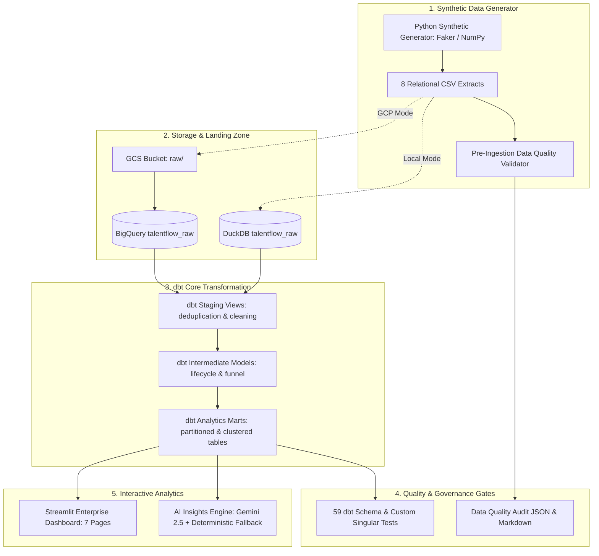

# TalentFlow – Recruiting & Employee Lifecycle Analytics Platform

[](https://www.python.org/downloads/)
[](https://docs.getdbt.com/)
[](https://duckdb.org/)
[](https://cloud.google.com/)
[](https://streamlit.io/)
[](https://pytest.org/)
[](https://docs.getdbt.com/docs/build/data-tests)

A production-grade, portfolio Analytics Engineering platform built to answer critical talent acquisition, workforce planning, and employee retention questions. Designed to reflect the exact technical expectations of an **Analytics Engineer – HR Analytics** at **Elastic**.

TalentFlow bridges upstream recruitment funnels (applications, screening, technical interviews, onsite loops, offers) with downstream workforce outcomes (tenure, annualized department attrition, engagement surveys, and performance ratings).

---

## 1. Business Problem & Analytical Objectives

Modern organizations struggle with disconnected HR data silos: applicant tracking systems (ATS), human resource information systems (HRIS), and engagement surveys operate independently. As a result, talent leaders cannot quantify how candidate sourcing choices affect long-term retention or where talent leaks out of the hiring funnel.

TalentFlow answers core business questions:
- **Funnel Drop-off**: Where in the hiring loop do candidates abandon or fail (Screen vs. Technical vs. Onsite)?
- **Sourcing ROI**: Which recruiting sources (Referrals, LinkedIn, Agencies, Campus) yield the highest retention and lowest cost per hire?
- **Hiring Velocity**: What is the average time to hire, and which departments have the longest stage latencies?
- **Workforce Retention**: What factors and job levels are correlated with early employee departure (< 180 days)?
- **Correlation vs. Causation**: Differentiating true workforce trends from observational artifacts.

> **Privacy Guarantee**: 100% of data is algorithmically generated synthetic data. No real personal, candidate, compensation, or confidential information is used.

---

## 2. End-to-End Architecture

TalentFlow supports **dual-engine execution**: an out-of-the-box local mode using **DuckDB** (no GCP credentials required) and a production mode using **Google Cloud Storage (GCS)**, **Google BigQuery**, and **Gemini 2.5 Flash**.



---

## 3. Technology Stack

- **Transformation**: `dbt Core 1.12.7` with `dbt-bigquery` and `dbt-duckdb`
- **Warehouse**: `Google BigQuery` (Production) / `DuckDB 1.1` (Local Embedded)
- **Data Lake Storage**: `Google Cloud Storage (GCS)`
- **Data Processing**: Python 3.12+, Pandas 2.2+, NumPy, PyArrow
- **Interactive UI**: Streamlit 1.42+, Plotly 6.0+
- **Testing & Quality**: pytest, dbt test (59 automated assertions)
- **AI Insights**: Google Gemini 2.5 Flash via `google-genai` SDK + Deterministic Rules Engine
- **Containerization**: Docker, Docker Compose

---

## 4. Repository & Directory Structure

```
talentflow-analytics-platform/
├── README.md                      # Platform documentation & master guide
├── requirements.txt               # Locked production dependencies
├── Dockerfile                     # Multi-stage production container
├── .env.example                   # Environment variable template
├── .gitignore                     # Git ignore rules for data, logs, keys
├── dbt_project/                   # Complete dbt transformation project
│   ├── dbt_project.yml            # dbt project definition & schema config
│   ├── profiles.yml               # Dual-target profile (dev DuckDB / prod BigQuery)
│   ├── macros/
│   │   ├── date_macros.sql        # Cross-dialect date difference & truncation
│   │   └── generate_schema_name.sql
│   ├── models/
│   │   ├── staging/               # Deduplication, typing, cleaning views
│   │   │   ├── sources.yml
│   │   │   ├── schema.yml
│   │   │   ├── stg_candidates.sql
│   │   │   ├── stg_applications.sql
│   │   │   ├── stg_interviews.sql
│   │   │   ├── stg_offers.sql
│   │   │   ├── stg_employees.sql
│   │   │   ├── stg_engagement_surveys.sql
│   │   │   ├── stg_departments.sql
│   │   │   └── stg_recruiting_sources.sql
│   │   ├── intermediate/          # Business logic joins & metrics
│   │   │   ├── schema.yml
│   │   │   ├── int_candidate_application_history.sql
│   │   │   ├── int_recruiting_funnel.sql
│   │   │   ├── int_employee_lifecycle.sql
│   │   │   └── int_employee_retention.sql
│   │   └── marts/                 # Partitioned and clustered analytics tables
│   │       ├── schema.yml
│   │       ├── dim_department.sql
│   │       ├── dim_recruiting_source.sql
│   │       ├── fct_recruiting_pipeline.sql
│   │       ├── fct_employee_lifecycle.sql
│   │       ├── fct_employee_attrition.sql
│   │       ├── fct_candidate_experience.sql
│   │       ├── mart_recruiting_kpis.sql
│   │       └── mart_workforce_kpis.sql
│   └── tests/                     # Singular custom data tests
│       └── assert_valid_hiring_date_sequence.sql
├── talentflow/                    # Python package source code
│   ├── config.py                  # Pydantic / dataclass settings
│   ├── pipeline.py                # 10-step pipeline orchestrator
│   ├── data_generation/           # Synthetic generator & schemas
│   ├── ingestion/                 # GCS uploader & BigQuery loader
│   ├── warehouse/                 # Connection abstraction (DuckDB & BigQuery)
│   ├── quality/                   # Python validation & reporting framework
│   ├── analytics/                 # Curated queries & KPI computations
│   ├── ai_insights/               # Gemini AI engine & deterministic fallback
│   └── dashboards/                # Streamlit 7-page interactive dashboard
│       ├── app.py                 # Streamlit entrypoint & router
│       ├── components.py          # Shared UI widgets & Plotly charts
│       └── pages/                 # 7 dedicated analytical pages
├── tests/                         # Pytest unit & integration test suite
└── docs/                          # Detailed architecture and data documentation
    ├── data_dictionary.md
    ├── data_models.md
    ├── pipeline_architecture.md
    ├── data_quality_framework.md
    ├── security_and_governance.md
    └── deployment_guide.md
```

---

## 5. Quickstart: Local Development Mode

No Google Cloud credentials required. Local mode runs in seconds using DuckDB!

### 1. Clone & Set Up Environment
```bash
git clone https://github.com/your-username/talentflow-analytics-platform.git
cd talentflow-analytics-platform

python -m venv .venv
# On Windows:
.venv\Scripts\activate
# On macOS/Linux:
source .venv/bin/activate

pip install -r requirements.txt
cp .env.example .env
```

### 2. Execute Complete 10-Step Pipeline
Run the single orchestration command to generate 20,000+ records, load DuckDB, build all 20 dbt models, and run all 59 tests:
```bash
python -m talentflow.pipeline --mode local
```
*Pipeline executes end-to-end in ~22 seconds with 100% test pass rate.*

### 3. Launch Streamlit Analytics Dashboard
```bash
streamlit run talentflow/dashboards/app.py
```
Open **`http://localhost:8501`** in your browser to interact with the platform.

### 4. Run Pytest Test Suite
```bash
pytest -v
```

---

## 6. Google Cloud Platform Deployment Mode

When deploying to GCP, TalentFlow activates real Google Cloud Storage and BigQuery interfaces:

### 1. Infrastructure Setup
```bash
gcloud config set project YOUR_PROJECT_ID
gcloud services enable storage.googleapis.com bigquery.googleapis.com datacatalog.googleapis.com

# Create GCS Bucket
gcloud storage buckets create gs://talentflow-data-lake-YOUR_PROJECT_ID --location=us-central1

# Create Service Account
gcloud iam service-accounts create sa-talentflow-pipeline \
    --display-name="TalentFlow Pipeline Runner"

gcloud projects add-iam-policy-binding YOUR_PROJECT_ID \
    --member="serviceAccount:sa-talentflow-pipeline@YOUR_PROJECT_ID.iam.gserviceaccount.com" \
    --role="roles/storage.objectAdmin"

gcloud projects add-iam-policy-binding YOUR_PROJECT_ID \
    --member="serviceAccount:sa-talentflow-pipeline@YOUR_PROJECT_ID.iam.gserviceaccount.com" \
    --role="roles/bigquery.dataEditor"

gcloud projects add-iam-policy-binding YOUR_PROJECT_ID \
    --member="serviceAccount:sa-talentflow-pipeline@YOUR_PROJECT_ID.iam.gserviceaccount.com" \
    --role="roles/bigquery.jobUser"

# Download Service Account Key
gcloud iam service-accounts keys create ./gcp-key.json \
    --iam-account="sa-talentflow-pipeline@YOUR_PROJECT_ID.iam.gserviceaccount.com"
```

### 2. Configure `.env`
```ini
TALENTFLOW_MODE=gcp
GCP_PROJECT_ID=YOUR_PROJECT_ID
GCP_REGION=us-central1
GCS_BUCKET_NAME=talentflow-data-lake-YOUR_PROJECT_ID
GOOGLE_APPLICATION_CREDENTIALS=./gcp-key.json
BQ_RAW_DATASET=talentflow_raw
BQ_STAGING_DATASET=talentflow_staging
BQ_ANALYTICS_DATASET=talentflow_analytics
GEMINI_API_KEY=YOUR_GEMINI_API_KEY
```

### 3. Run GCP Pipeline
```bash
python -m talentflow.pipeline --mode gcp
```

---

## 7. Interactive Dashboard Tour (7 Pages)

| Page | Key Capabilities | Primary Metrics & Visualizations |
|---|---|---|
| **1. Executive Overview** | High-level talent & workforce health | Applications, Hires, Avg Time-to-Hire, Offer Acceptance %, Monthly Trajectory, Headcount by Dept |
| **2. Recruiting Funnel** | Stage conversion & drop-off bottlenecks | Stage-by-stage drop-off funnel, Screen vs Tech vs Onsite conversion, Stage duration latency bars |
| **3. Recruiting Sources** | Channel economics & sourcing ROI | Applications vs Hires by channel, Offer acceptance by source, Sourcing channel churn & tenure |
| **4. Workforce Analytics** | Headcount demographics & turnover | Geo distribution donut, Tenure bands (<3m to 2y+), Active vs Departed breakdown, Attrition segments |
| **5. Employee Lifecycle** | Cross-lifecycle recruiting impact | Retention by recruiting source, Engagement radar chart across tenure cohorts, Correlation vs Causation notice |
| **6. Data Quality & Audit** | Quality gate monitoring & compliance | Pre-ingestion check summary, Controlled anomaly detection logs, BigQuery IAM & column-level security |
| **7. AI-Powered Insights** | Natural language executive queries | Curated analytical questions, Gemini 2.5 Flash summarization + Deterministic rules engine fallback |

---

## 8. Data Quality & Controlled Anomaly Framework

TalentFlow intentionally injects **controlled data quality scenarios** into synthetic raw extracts to prove validation and cleaning capabilities:
- **Inconsistent Department Casing**: Typo strings (`'Eng'`, `'Sales '`, `'CS'`) are mapped to canonical keys in `stg_applications`.
- **Negative Date Sequences**: Injected date order violations are flagged by the pre-ingestion validator and verified by singular test `assert_valid_hiring_date_sequence.sql`.
- **Duplicate Records**: Primary key violations are deduplicated via window function `ROW_NUMBER() OVER (...)`.
- **Missing Optional Attributes**: Controlled null phone numbers and decline reasons are assigned clean fallbacks.

Audit reports are automatically saved to `data/reports/data_quality_report.json` and `data/reports/data_quality_report.md`.

---

## 9. Security, IAM, and HR Governance

- **PII Protection**: Personal identifiers (`email`, `phone`) are restricted and masked via BigQuery Policy Tags.
- **Compensation Restrictions**: Salary, bonus, and equity figures are governed by column-level access controls.
- **Audit Logging**: Application logs exclude confidential candidate PII and compensation figures.
- **Least Privilege**: Distinct IAM roles for Pipeline Service Accounts, Analytics Engineers, and HR Stakeholders.

---

## 10. Troubleshooting & Known Limitations

- **Concurrent DuckDB Lock (Windows)**: DuckDB acquires exclusive write locks. The pipeline automatically closes raw engine connections before running dbt.
- **dbt Version Check in Isolated Environments**: If running in a firewalled environment, pass `--no-version-check --no-send-anonymous-usage-stats` (pre-configured in `pipeline.py`).
- **BigQuery Quota Limits**: In GCP mode, queries against partitioned fact tables should include date filters to minimize partition scanning.

---

## 11. License

MIT License. Developed as a portfolio-grade demonstration of modern Analytics Engineering in HR Analytics.
