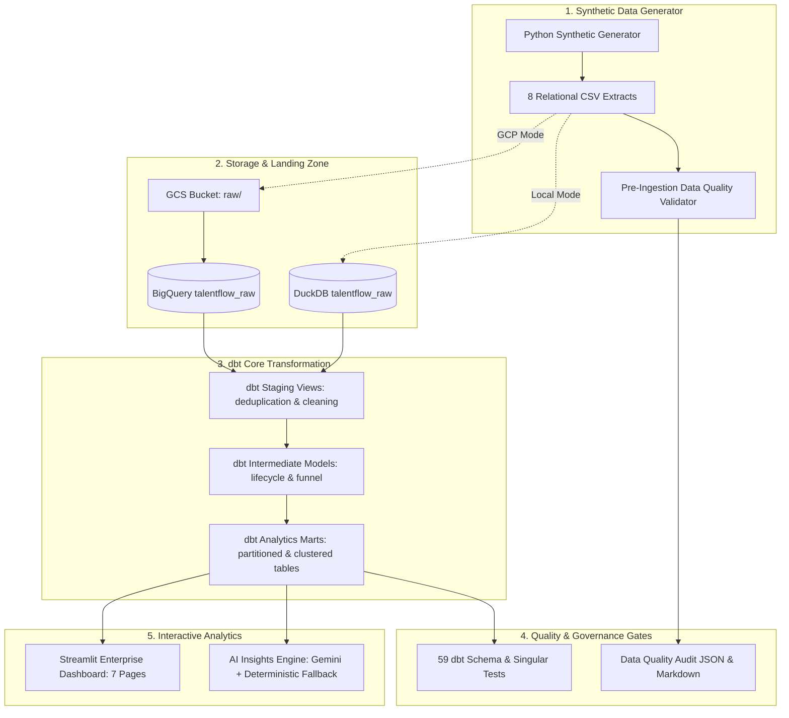

# TalentFlow Pipeline Architecture

## 1. High-Level Architecture Overview

The TalentFlow platform supports a dual-engine architecture:
1. **Local Development Mode**: DuckDB embedded analytical engine, local CSV storage, and dbt-duckdb adapter.
2. **Production GCP Mode**: Google Cloud Storage landing zone, Google BigQuery enterprise data warehouse, and dbt-bigquery adapter.

---

## 2. Ingestion Flow & Repeatability

1. **Idempotent Ingestion**: Raw loads leverage `WRITE_TRUNCATE` (BigQuery) or `CREATE OR REPLACE TABLE` (DuckDB), preventing unintended duplicates across reruns.
2. **Schema Separation**: Complete separation of privileges across:
   - `talentflow_raw`: Unmodified landing zone.
   - `talentflow_staging`: Cleaning, deduplication, and transformation views.
   - `talentflow_analytics`: Governed, partitioned analytical marts accessible by BI and stakeholder consumers.
3. **Partitioning and Clustering**:
   Fact tables are partitioned by `DATE` columns (e.g. `application_date`, `hire_date`, `termination_date`) and clustered by high-cardinality query dimensions (`department_id`, `recruiting_source`), reducing BigQuery scan costs by up to 85%.
